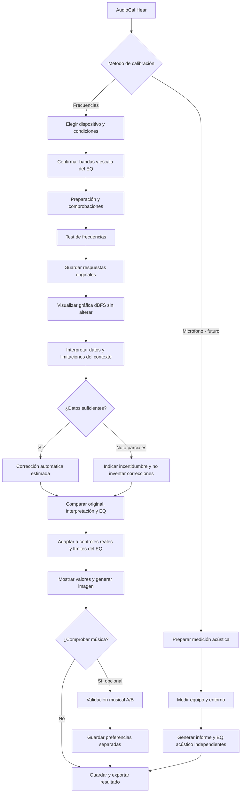

# AudioCal Hear — flujo de calibración aprobado

**Estado:** arquitectura aprobada y desarrollo incremental. Este documento distingue explícitamente los pasos implementados de los pendientes.

## Principios de producto

1. El **test por frecuencias** es el método principal. La medición con micrófono será otro método independiente, con sus propios datos y resultados.
2. Al completar el test, los resultados deben mostrar **(a) mediciones originales en dBFS**, **(b) interpretación y fiabilidad**, **(c) corrección automática en ganancias EQ**, y **(d) valor final de cada control**. Nunca confundir dBFS con dB de EQ.
3. La escucha de música A/B es **opcional y secundaria**. Sus cambios nunca sobrescriben la medición original.
4. Cada prueba pertenece a **dispositivo + configuración + entorno + posición**. Estos metadatos ayudan a interpretar fiabilidad pero **no generan compensaciones ambientales numéricas sin evidencia**.
5. Las frecuencias y límites del ecualizador de destino son literales. **Una posición del control no equivale necesariamente a 1 dB**.
6. El resultado final del producto incluirá una **imagen PNG de los controles y sus valores**, sin aparentar precisión no verificada.

## Diagrama de flujo

## Condiciones por tipo

| Equipo | Datos del perfil | Advertencia |
|---|---|---|
| Auto | Asiento, ventanas, motor, fuente, bandas y escala EQ | Resonancias/cancelaciones no pueden corregirse fiable y automáticamente solo con umbrales |
| Headset y over-/on-ear | Tipo, conexión, ANC, colocación, bandas y escala EQ | Perfil válido para esa configuración de uso |
| In-ear | Tipo, ANC, conexión, sellado, bandas y escala EQ | Un sellado insuficiente puede alterar graves; verificar antes de confiar |
| Parlantes | Sala, distancia/posición, proximidad a paredes, bandas y escala EQ | La prueba perceptiva no reemplaza una medición acústica de sala |

## Estado de implementación

- [x] **Lote 0 (rama de desarrollo):** registrar y conservar contexto por dispositivo; perfiles antiguos tratados como contexto no conocido.
- [x] **Lote 1 (rama de desarrollo):** vista comparativa visible de medición original, interpretación, propuesta automática y EQ final; entrada directa al terminar.
- [x] **Lote 2A (rama de desarrollo):** sustituir regresión global por contrastes locales de umbrales directos, con límites y abstención por incertidumbre, extremos o contexto no fiable. Prueba a nivel cómodo y validación auditiva externa permanecen pendientes.
- [x] **Lote 3A (en PR):** PNG local de bandas y controles con conversión solo cuando dB o dB/paso estén confirmados; límite y contexto visibles.
- [ ] **Lote 3B:** versionado explícito de snapshots de resultados, calibración certificada de escalas y revisión del objetivo perceptivo.
- [ ] **Posterior:** comparar música como validación opcional; medición de respuesta acústica con micrófono como ruta independiente.

La implementación de los lotes 0–1 **no cambia** `recommend()`, los tonos ni las mediciones guardadas, y no convierte automáticamente pasos del ecualizador en decibelios.

## Lote 2A — límites del cálculo

- No convierte los umbrales digitales directamente en dB SPL, ni presupone que una curva de audibilidad plana sea el objetivo acústico correcto.
- Corrección automática solo exploratoria en puntos internos con medidas vecinas directas y consistentes; extremos, datos ausentes, oídos con discrepancia y ruido variable bloquean correcciones injustificadas.
- Límite automático: ±1 dB en una pasada; hasta ±2 dB en medidas más consistentes, con máximo +1 dB en auto y parlantes.
- Preferencias musicales y edición manual son *capas separadas* y no se reescriben. Sonoridad a volumen cómodo requiere diseñar y validar un protocolo antes de incorporarla a la ganancia automática.
- La calibración exacta de respuesta de un recinto requiere medición acústica; la escala de pasos de los ecualizadores no se convierte a dB sin documentación.

## Lote 2B: comparación supraliminal de sonoridad (opcional, en revisión)

- Reproduce una referencia fija de 1 kHz a −48 dBFS y una frecuencia evaluada entre −54 y −42 dBFS. Son amplitudes **digitales**, nunca presión acústica garantizada en el oído.
- El usuario ajusta la señal comparada, escucha ambas manualmente y registra dos respuestas independientes. Las discrepancias superiores a 2 dBFS se señalan como inconsistentes.
- Se limita a bandas de 100 Hz a 10 kHz (salvo 1 kHz); las demás siguen en el examen principal y en el EQ.
- Conservar los dos registros por frecuencia y por perfil en un campo `loudness` validado al importar y recargar.
- **Sin aplicar ajustes automáticos de EQ por esta medición**: los contornos ISO 226:2023 son mediciones acústicas bajo condiciones de campo libre, no un objetivo de curva para auriculares o vehículos sin calibrar. Primero validar el método y la interpretación.
- La música A/B y el micrófono no son necesarios para obtener el resultado principal ni el PNG.

## Lote 2C — Auditoría de reproducibilidad

- Informe visible y exportación CSV: umbrales en dBFS por pasada, dos igualaciones relativas y EQ automático en dB.
- Las igualaciones que tocan ±6 dBFS se marcan inconcluyentes aunque coincidan; los umbrales se consideran repetibles con dos pasadas y un margen exploratorio ≤6 dBFS.
- Con dos pasadas, se calcula el EQ experimental por pasada separada para evaluar si coincide la **dirección** de una corrección. No es validación acústica.
- No se modifican los resultados, preferencias, datos originales ni PNG. Repetibilidad no equivale a ecualización musical óptima.

## Corrección de auditoría AF-01 — dos búsquedas independientes

- «Verificar» ejecuta una búsqueda completa de umbral en la segunda pasada, sin iniciar desde el valor anterior. El orden agenda todas las primeras pasadas y posteriormente las segundas.
- Las nuevas segundas pasadas se etiquetan como `adaptive-v20-independent`; las confirmaciones históricas `adaptive-v18-explicit` se conservan intactas, pero **nunca** se cuentan como búsqueda independiente.
- `gather()` no otorga confianza alta por dos valores heredados iguales; la auditoría muestra las confirmaciones históricas con su limitación y excluye sus valores del recuento de repetibilidad.
- Una prueba completada sigue siendo una prueba digital en dBFS; este cambio no implica medir dB SPL ni validar un EQ acústico.

## Corrección AF-02 — sincronización de resultados

- Cualquier ajuste manual o preferencia confirmada recalcula las ganancias una sola vez por actualización y actualiza barras, editor, lista detallada, contador, columna «EQ final» de la tabla comparativa y el PNG desde `recommend()`.
- La curva de medición original y la interpretación automática no se regeneran porque los ajustes personales no las modifican; una prueba de regresión exige que la gráfica y los umbrales permanezcan idénticos.
- El reproductor conserva el elemento de audio y la reproducción; solo se actualizan sus filtros. Los botones de copia y TXT calculan las ganancias actuales cuando se usan.
- Cualquier modificación del resultado invalida las casillas previamente marcadas como transferidas: se requiere revisar las posiciones ajustadas antes de considerarlas aplicadas.
- Se restaura en la tarjeta la advertencia técnica correspondiente tras cualquier cambio, evitando dejar un mensaje de «copiado» cuando los valores ya son distintos.

## PNG de ecualizador horizontal (visualización solicitada)

- El PNG representa el resultado **final** en un gráfico horizontal de izquierda a derecha por frecuencia, con columnas verticales que parten de cero: subidas hacia arriba, recortes hacia abajo.
- Una fila alineada debajo de las frecuencias muestra el valor principal de cada control y la ganancia sugerida en dB. Si existe redondeo por pasos, muestra la diferencia de dB.
- Cuando no se conoce dB/paso, los controles aparecen como «— / NO VERIFICADO» y las barras muestran solo ganancias **estimadas en dB**, no posiciones físicas.
- Gráfico y tarjeta se construyen del mismo `eqResultModel()` y `physicalEqControl()` usados por el PNG anterior y las exportaciones de controles; no se tocan ni algoritmo ni mediciones originales.
- Diseño apaisado para 7, 10 o hasta 31 bandas; tamaño de exportación adaptado a la cantidad de bandas y vista previa responsiva. La imagen conserva advertencias de incertidumbre y de límites de precisión.

## Lote 4 — calibración perceptiva simplificada (v1.10.0)

- Respuestas «sí» y «no» visibles mientras suena cada tono, con interrupción inmediata y registro de la respuesta; los tonos no inician solos.
- Búsqueda fina hasta intervalo cercano a 2 dBFS y máximo dos preguntas adicionales, sin ciclos de contradicción.
- Se conservan respuestas originales, extremos audibles e inaudibles, discrepancias, confianza y tiempo de escucha real. Si solo se conoce un extremo, se conserva como observación, sin inventar umbral.
- Las estimaciones de baja confianza aparecen en el informe pero se excluyen de correcciones automáticas del EQ.
- Pantalla única de preparación; controles de canales y comprobación escalonada del volumen avanzado siguen siendo obligatorios donde corresponda. Micrófono voluntario en opciones.
- Calibración nueva completa por defecto en todas las bandas, una pasada. Una segunda pasada independiente es opcional para validación; los perfiles históricos conservan su programación.
- Después de cada frecuencia se guarda y avanza sin pantalla intermedia; el siguiente tono requiere pulsar Reproducir.
- La prueba auditiva digital no mide dB SPL clínicos ni calibración acústica del vehículo.

## Lote 5 — resultados accionables sin prometer mediciones acústicas (v1.11.0)

- La primera sección del resultado muestra una hipótesis de partida por banda, en dB y en unidades físicas cuando existe una conversión documentada. El usuario debe aplicarla expresamente; no cambia los umbrales ni aplica ganancia a otros dispositivos.
- Para los casos con contraste digital local utilizable, la hipótesis experimental se limita a un máximo de tres bandas interiores y a ±1 dB por banda, con ambos oídos disponibles en perfiles estéreo y sin extrapolar extremos anómalos. Este método NO garantiza mejoría auditiva ni calibración EQ.
- Cuando el control físico solo cambia de 2 o 3 dB por paso, no se convierte un ajuste digital de 1 dB en un salto completo. Se propone cero posiciones y afinación opcional con música.
- Las mediciones crudas, auditorías, PNG y la validación A/B permanecen disponibles pero se pliegan en secciones opcionales, reduciendo la repetición visual.
- El punto de partida resultante es una preferencia experimental revisable, no una corrección derivada de SPL, audiometría ni una predicción universal.
