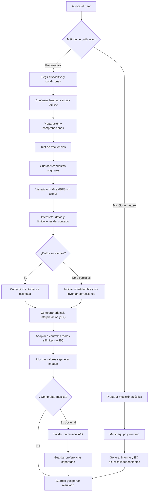

# AudioCal Hear — flujo de calibración aprobado

**Estado:** arquitectura aprobada y desarrollo incremental. Este documento distingue explícitamente los pasos implementados de los pendientes.

## Principios de producto

1. El **test por frecuencias** es el método principal. La medición con micrófono será otro método independiente, con sus propios datos y resultados.
2. Al completar el test, los resultados deben mostrar **(a) mediciones originales en dBFS**, **(b) interpretación y fiabilidad**, **(c) corrección automática en ganancias EQ**, y **(d) valor final de cada control**. Nunca confundir dBFS con dB de EQ.
3. La escucha de música A/B es **opcional y secundaria**. Sus cambios nunca sobrescriben la medición original.
4. Cada prueba pertenece a **dispositivo + configuración + entorno + posición**. Estos metadatos ayudan a interpretar fiabilidad pero **no generan compensaciones ambientales numéricas sin evidencia**.
5. Las frecuencias y límites del ecualizador de destino son literales. **Una posición del control no equivale necesariamente a 1 dB**.
6. El resultado final del producto incluirá una **imagen PNG de los controles y sus valores**, sin aparentar precisión no verificada.

## Diagrama de flujo

## Condiciones por tipo

| Equipo | Datos del perfil | Advertencia |
|---|---|---|
| Auto | Asiento, ventanas, motor, fuente, bandas y escala EQ | Resonancias/cancelaciones no pueden corregirse fiable y automáticamente solo con umbrales |
| Headset y over-/on-ear | Tipo, conexión, ANC, colocación, bandas y escala EQ | Perfil válido para esa configuración de uso |
| In-ear | Tipo, ANC, conexión, sellado, bandas y escala EQ | Un sellado insuficiente puede alterar graves; verificar antes de confiar |
| Parlantes | Sala, distancia/posición, proximidad a paredes, bandas y escala EQ | La prueba perceptiva no reemplaza una medición acústica de sala |

## Estado de implementación

- [x] **Lote 0 (rama de desarrollo):** registrar y conservar contexto por dispositivo; perfiles antiguos tratados como contexto no conocido.
- [x] **Lote 1 (rama de desarrollo):** vista comparativa visible de medición original, interpretación, propuesta automática y EQ final; entrada directa al terminar.
- [ ] **Lote 2:** revisar con validación técnica la conversión de umbrales a EQ, igualación a nivel cómodo, sesgos y límites.
- [ ] **Lote 3:** mapa validado a posiciones exactas del EQ, exportación PNG y trazabilidad de la versión del algoritmo/snapshot.
- [ ] **Posterior:** comparar música como validación opcional; medición de respuesta acústica con micrófono como ruta independiente.

La implementación de los lotes 0–1 **no cambia** `recommend()`, los tonos ni las mediciones guardadas, y no convierte automáticamente pasos del ecualizador en decibelios.
