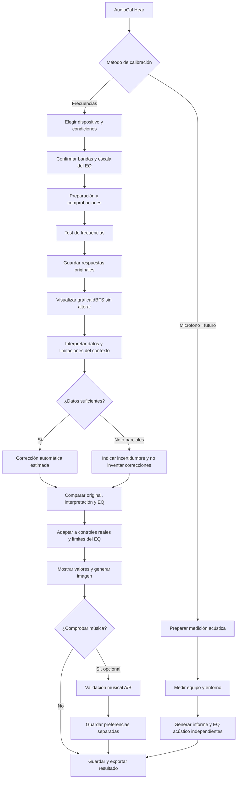

# AudioCal Hear — flujo de calibración aprobado

**Estado:** arquitectura aprobada y desarrollo incremental. Este documento distingue explícitamente los pasos implementados de los pendientes.

## Principios de producto

1. El **test por frecuencias** es el método principal. La medición con micrófono será otro método independiente, con sus propios datos y resultados.
2. Al completar el test, los resultados deben mostrar **(a) mediciones originales en dBFS**, **(b) interpretación y fiabilidad**, **(c) corrección automática en ganancias EQ**, y **(d) valor final de cada control**. Nunca confundir dBFS con dB de EQ.
3. La escucha de música A/B es **opcional y secundaria**. Sus cambios nunca sobrescriben la medición original.
4. Cada prueba pertenece a **dispositivo + configuración + entorno + posición**. Estos metadatos ayudan a interpretar fiabilidad pero **no generan compensaciones ambientales numéricas sin evidencia**.
5. Las frecuencias y límites del ecualizador de destino son literales. **Una posición del control no equivale necesariamente a 1 dB**.
6. El resultado final del producto incluirá una **imagen PNG de los controles y sus valores**, sin aparentar precisión no verificada.

## Diagrama de flujo

## Condiciones por tipo

| Equipo | Datos del perfil | Advertencia |
|---|---|---|
| Auto | Asiento, ventanas, motor, fuente, bandas y escala EQ | Resonancias/cancelaciones no pueden corregirse fiable y automáticamente solo con umbrales |
| Headset y over-/on-ear | Tipo, conexión, ANC, colocación, bandas y escala EQ | Perfil válido para esa configuración de uso |
| In-ear | Tipo, ANC, conexión, sellado, bandas y escala EQ | Un sellado insuficiente puede alterar graves; verificar antes de confiar |
| Parlantes | Sala, distancia/posición, proximidad a paredes, bandas y escala EQ | La prueba perceptiva no reemplaza una medición acústica de sala |

## Estado de implementación

- [x] **Lote 0 (rama de desarrollo):** registrar y conservar contexto por dispositivo; perfiles antiguos tratados como contexto no conocido.
- [x] **Lote 1 (rama de desarrollo):** vista comparativa visible de medición original, interpretación, propuesta automática y EQ final; entrada directa al terminar.
- [x] **Lote 2A (rama de desarrollo):** sustituir regresión global por contrastes locales de umbrales directos, con límites y abstención por incertidumbre, extremos o contexto no fiable. Prueba a nivel cómodo y validación auditiva externa permanecen pendientes.
- [x] **Lote 3A (en PR):** PNG local de bandas y controles con conversión solo cuando dB o dB/paso estén confirmados; límite y contexto visibles.
- [ ] **Lote 3B:** versionado explícito de snapshots de resultados, calibración certificada de escalas y revisión del objetivo perceptivo.
- [ ] **Posterior:** comparar música como validación opcional; medición de respuesta acústica con micrófono como ruta independiente.

La implementación de los lotes 0–1 **no cambia** `recommend()`, los tonos ni las mediciones guardadas, y no convierte automáticamente pasos del ecualizador en decibelios.

## Lote 2A — límites del cálculo

- No convierte los umbrales digitales directamente en dB SPL, ni presupone que una curva de audibilidad plana sea el objetivo acústico correcto.
- Corrección automática solo exploratoria en puntos internos con medidas vecinas directas y consistentes; extremos, datos ausentes, oídos con discrepancia y ruido variable bloquean correcciones injustificadas.
- Límite automático: ±1 dB en una pasada; hasta ±2 dB en medidas más consistentes, con máximo +1 dB en auto y parlantes.
- Preferencias musicales y edición manual son *capas separadas* y no se reescriben. Sonoridad a volumen cómodo requiere diseñar y validar un protocolo antes de incorporarla a la ganancia automática.
- La calibración exacta de respuesta de un recinto requiere medición acústica; la escala de pasos de los ecualizadores no se convierte a dB sin documentación.

## Lote 2B: comparación supraliminal de sonoridad (opcional, en revisión)

- Reproduce una referencia fija de 1 kHz a −48 dBFS y una frecuencia evaluada entre −54 y −42 dBFS. Son amplitudes **digitales**, nunca presión acústica garantizada en el oído.
- El usuario ajusta la señal comparada, escucha ambas manualmente y registra dos respuestas independientes. Las discrepancias superiores a 2 dBFS se señalan como inconsistentes.
- Se limita a bandas de 100 Hz a 10 kHz (salvo 1 kHz); las demás siguen en el examen principal y en el EQ.
- Conservar los dos registros por frecuencia y por perfil en un campo `loudness` validado al importar y recargar.
- **Sin aplicar ajustes automáticos de EQ por esta medición**: los contornos ISO 226:2023 son mediciones acústicas bajo condiciones de campo libre, no un objetivo de curva para auriculares o vehículos sin calibrar. Primero validar el método y la interpretación.
- La música A/B y el micrófono no son necesarios para obtener el resultado principal ni el PNG.
