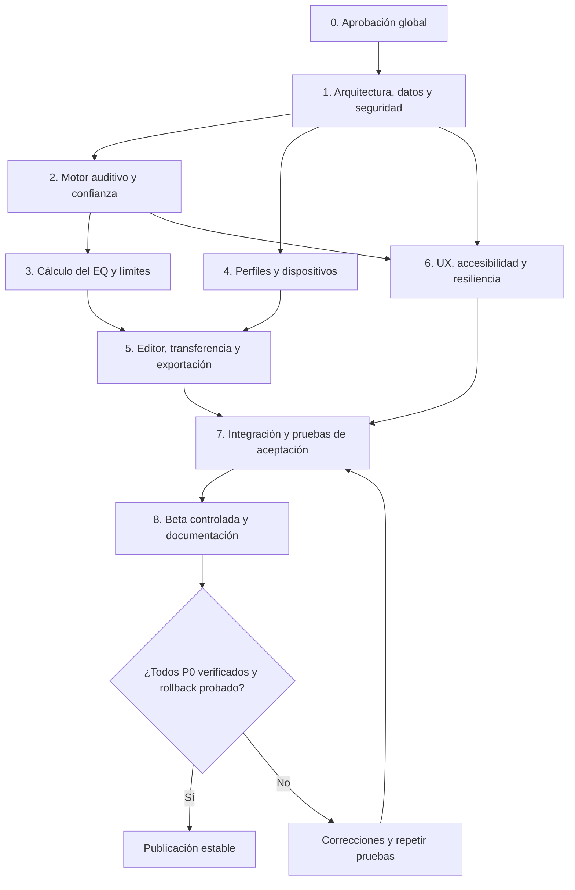

# Plan de implementación por etapas — Hear 3.0

> **Actualización de estado (2026-11-04):** el usuario aprobó expresamente el alcance maestro y el plan por etapas para comenzar la implementación. La versión original, redactada antes de la aprobación, se conserva como registro de la auditoría. Esta aprobación **no valida pruebas acústicas ni habilita publicación estable**; D-063 sigue siendo la puerta de salida. Esta rama contiene los primeros contratos de la fase 1 y ninguna modificación de la aplicación oficial.

> **DOCUMENTO DE REVISIÓN ORIGINAL · APROBACIÓN GLOBAL CONCEDIDA EL 04/11/2026**  
> Fuente de verdad: [issue #30](https://github.com/PoldKent/AudioCal-Hear/issues/30). Las 63 decisiones originales permanecen íntegras en GitHub. Este documento las resume para revisión; ante cualquier diferencia, prevalece el texto aprobado del issue. No implica que alguna función haya sido implementada, validada ni publicada.  
> Corte de revisión: 4 de noviembre de 2026.  

## Principios de ejecución

- **Punto de partida:** aplicación en `main` documentada como v1.11.0 / Hear 2.0 preview. No se inspeccionó exhaustivamente el código ni se ejecutaron pruebas actuales; el plan describe trabajo futuro, no avances hechos.
- **Puerta 0:** aprobación explícita del usuario del alcance y del presente plan. Ningún cambio de código/interfaz de V3 antes de superar esta puerta.
- Implementar en ramas/PRs pequeños; revisión, prueba y reversión independiente. Mantener públicos los estados de especificado, implementado y validado. No hacer pasar una demo visual por validación real de audio.
- La preparación de un P0 no implica que todos los modelos de hardware estén validados. Despliegue estable solo con **todos los P0 implementados y verificados**, pruebas críticas aprobadas y plan de reversión.

## Dependencias de alto nivel

## Entregables y puertas de calidad por fase

| Fase | Objetivo y tareas principales | D trazadas | Entrega / Puerta de salida |
|---|---|---|---|
| **0. Aprobación de especificación** | Resolver G-01, interpretar G-02; aprobar tabla de requisitos, alcance P0 y exclusiones, matriz de compatibilidad prevista | D-001–063 | Aprobación **expresa**; sin código |
| **1. Fundaciones y contratos** | Inventariar arquitectura V2; establecer contratos datos/versiones, eventos de audio, salidas, límites y estados, estrategia de test y migración sin cambiar versión pública todavía | D-003, 006, 019, 033–037, 042, 051, 054–057, 059–060, 063 | Diseño revisado; test de regresión V2 y primer esquema de evidencia |
| **2. Motor de tonos** | Barrido + discretos, secuencia adaptativa, pasos/duración, detener/atrás, contradicciones, confianza e inconclusos | D-001–009, 014, 021–022, 028–038 | Casos sintéticos de tonos/estados y pruebas navegador; fail-safe |
| **3. Motor de EQ experimental** | Corpus y comparación de algoritmos, confianza, combinación L/R, política de ganancias/headroom y neutralidad justificable | D-010, 015, 039–041, 047 | Elección documentada por evidencias; no topes inventados |
| **4. Dispositivos y compatibilidad** | Perfiles 2–31, frecuencias, foto/manual, escalas y redondeo, catálogo de compatibilidad trazable | D-020, 035, 042–046, 052–053, 059 | Casos verificados por categoría + modo no verificado correctamente etiquetado |
| **5. Resultado y transferencia** | Único EQ, barras, edición original vs vigente, guía, copiar/TXT/CSV/PNG, restauración, backups locales | D-015–027, 041, 047–051 | Igualdad entre editor/exportaciones; importación y borrado seguro |
| **6. Resiliencia, privacidad y accesibilidad** | Retomar sin audio inesperado, cambios de ruta, offline, permisos, diagnósticos opt-in, mejoras móviles, WCAG como objetivo | D-017–019, 025–027, 054–062 | Matriz navegadores, accesibilidad manual/auto, borrado, pérdida de persistencia, integración |
| **7. Integración y hardening** | E2E por plataformas; simulación de fallos; límites y seguridad; evidencias por ID, migraciones y reversión | Todos los P0 + D-063 | 0 bloqueos críticos abiertos; todos los P0 verificables o detener salida estable |
| **8. Beta y decisión de release** | Beta explícitamente experimental en entorno separado, recoger errores voluntarios, documentar limitaciones, probar plan de rollback | D-053, 057, 061, 063 | Publicar **estable** solo tras condiciones D-063=C |

## Estrategia PR aprobada para ejecución por etapas

1. `test/contracts`: baseline de pruebas y matrices de audio/estado, datos y seguridad.
2. `feat/tone-engine`: secuenciación, barrido, tonos, confianza, límites; PR dividido si es grande.
3. `feat/eq-research`: experimentación reproducible separada de la UI; selección tras evidencias.
4. `feat/device-profiles`: catálogo y formatos 2–31, procedencia y representación real.
5. `feat/eq-transfer`: un EQ, editor, copias/exports/guías y compatibilidad validada.
6. `feat/local-data`: schema/versionado, respaldo, errores, offline y privacidad.
7. `feat/hear3-ui`: diseño responsive, navegación, accesibilidad y progreso.
8. `test/release-gates`: regresión, hardening, beta y reversión. **Abrir ramas/PR de forma incremental, con comprobaciones y revisión; el primer PR es de contratos.**

## Matriz inicial de validación (a confirmar tras inventario)

- **Navegadores y OS:** Chromium desktop + Android, WebKit/Safari iOS/macOS y Firefox desktop/móvil según capacidad; solo afirmar compatibilidad donde existan pruebas reales.
- **Rutas de audio:** altavoces internos, cable, Bluetooth/TWS, rutas de automóvil y equipo pro representativo; ninguna marca/modelo se presume validado por categoría.
- **Bordes:** cambio/desconexión de auriculares, foco, llamada observable, suspensión, pérdida de Internet, almacenamiento lleno/bloqueado, corrupción/importación, límites digitales, respuesta durante tono, franja de incertidumbre, oído L/R no verificable, 2,4,5,7,10,15,31 bandas y personalizados, redondeos y filtros paramétricos guiados manualmente.
- **Accesibilidad:** zoom, teclado, lectores de pantalla, contraste, tamaño táctil, movimiento reducido, foco/estados.
- **Seguridad:** no SPL fingido, no autoincrementos por encima de topes, ampliación avanzada explícita cuando se habilite, audio detenido con seguridad, no reanudar sin acción.

## Indicadores de avance (evidencia, no marketing)

Para cada D-XXX registrar: `especificado` / `implementado en PR` / `revisado` / `prueba automatizada aprobada` / `prueba manual/dispositivo aprobada si aplica` / `limitación pública`. **Progreso de ingeniería y porcentaje completado deben calcularse sólo sobre implementaciones verificadas, no sobre las 63 respuestas del cuestionario.**

## Cierre de la fase documental

**Estado actualizado: aprobado globalmente el 04/11/2026 para ejecución por etapas.** Inicio de fase 1 en PR aislado; prioridades individuales no fijadas siguen marcadas como pendientes, sin inventarlas. El código oficial de Hear 2.0 no se altera por este documento.